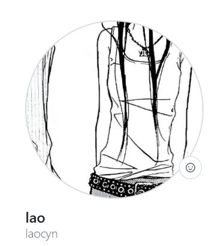

# МОЙ_ИТ_ПОРТФОЛИО

> **Дата запуска:** 28.10.2026
> **Студент:** Краснухина Варвара

---

## ОПИСАНИЕ
Это мой первый репозиторий, созданный на парах 'Введение в специальность'. Здесь я буду собирать все свои работы.

## ТЕКУЩИЕ_НАВЫКИ
* Настройка Git через VS Code
* Работа с облаком GitHub
* Основы Markdown разметки

## ССЫЛКИ
(https://github.com/laocyn)
]([])